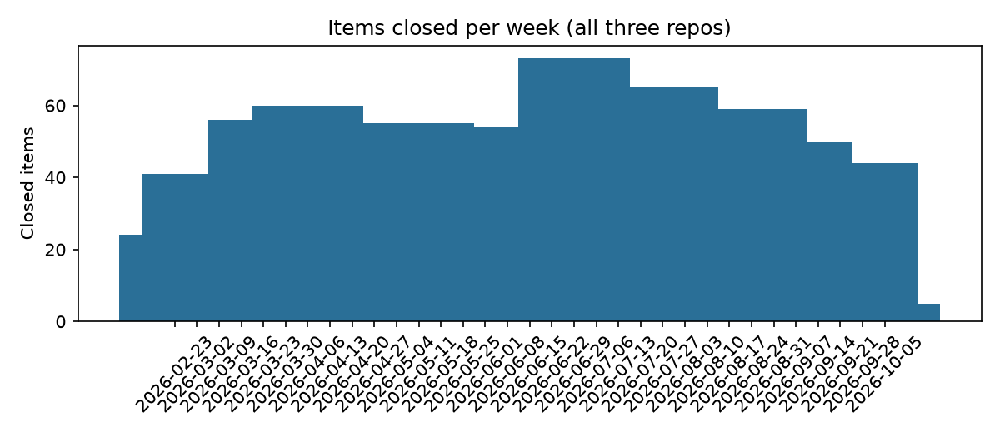

# Software Delivery Metrics & Open-Bug Risk Register

**Author:** Aadit Vora

**Role focus:** Project / Program Manager · **Tools:** Python (GitHub REST API), SQL (DuckDB), pytest

> **Business question:** How fast and how steadily are three active open-source projects moving work through, where is work aging, and which open bugs need an owner now?

Source: GitHub REST API, issues and pull requests from `pallets/flask`, `psf/requests`, and `pydantic/pydantic`. The snapshot was taken on 2026-10-05.

## Headline results

Population: items created from **2026-02-23** onward. That is the first date all three repos are fully covered (see Method).

| Metric | Value |
|---|---:|
| Items closed in window | 1,432 |
| Average closed per week (all three repos) | **43.4** |
| Open items at snapshot | 130 |
| Open items older than 90 days | **57 (44%)** |
| Open bugs | 21 |
| Open bugs older than 90 days | **10** |
| Median age of open items | 77.5 days |

**Cycle time (created → closed), median:**

| Repo | Issues | Pull requests |
|---|---:|---:|
| pallets/flask | 0.3 h | 0.2 h |
| psf/requests | 1.6 h | 1.5 h |
| pydantic/pydantic | **25.8 h** | 1.8 h |

Pydantic issues have a long tail. The 85th percentile is 16 days, against 3.3 days for its pull requests. Most of the open backlog is also here: 94 of 130 open items, 35 of them stale.



## Risk register

`outputs/risk_register_open_bugs.csv` lists the 10 open bugs older than 90 days, oldest first, with links. Each row is a candidate for triage: confirm it is still a bug, assign an owner, and decide whether to fix, defer, or close it.

## Recommendation

1. Run a stale-bug triage on pydantic. Ten bugs have been open over 90 days, ranging from 107 to 217 days old.
2. Treat issue cycle time as a separate queue from pull requests. Pydantic's issue queue behaves very differently from its PR flow.
3. Watch the stale-share KPI each week. It is 44% today, and it is the clearest early warning of a growing backlog.

## Method

- `src/fetch.py` pages through the issues API (which includes pull requests) with a 12-month `since` filter, and writes raw JSON plus a `manifest.json` with the snapshot time and counts.
- `src/build.py` flattens items and detects bugs by label (`bug`, `type: bug`, and variants such as pydantic's `bug V2`).
- **Coverage window:** GitHub stops returning list pages after about 1,000 results. Pydantic hit that ceiling and only has items from 2026-02-23 onward. Metrics use that common start date, so no repo is measured over a period where part of its data is missing.
- `sql/` holds the staging and marts: throughput, cycle time, and open-backlog aging.
- `tests/test_pipeline.py` checks counts against raw JSON, unique keys, close dates after create dates, the coverage cutoff, and the bug-label variant.

## Limitations

- Three projects, one snapshot. These are open-source projects with different workflows. Use them as a method, not a benchmark.
- Cycle time uses created → closed, so it includes time before work started. Closed items are biased toward shorter work.
- Labels are applied by maintainers, so bug counts depend on labelling discipline.
- Re-running `fetch.py` gives a new snapshot. Results are reproducible from the saved `data/raw/`, not from the live API.

## Reproduce

```bash
python -m pip install -r requirements.txt
export GITHUB_TOKEN=...     # optional: raises the API limit from 60 to 5,000 requests/hour
python src/fetch.py         # writes data/raw/ and manifest.json
python src/analysis.py      # writes outputs/ and figures/
python -m pytest -q         # 7 tests, against the saved snapshot
```
